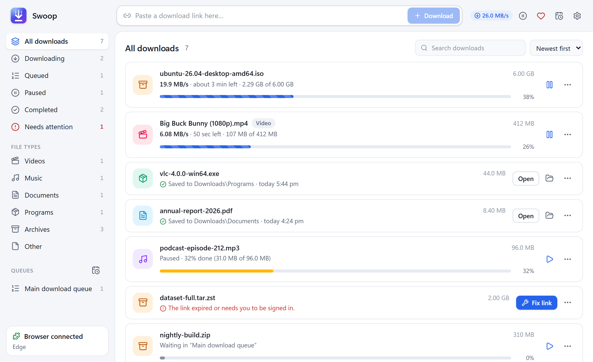
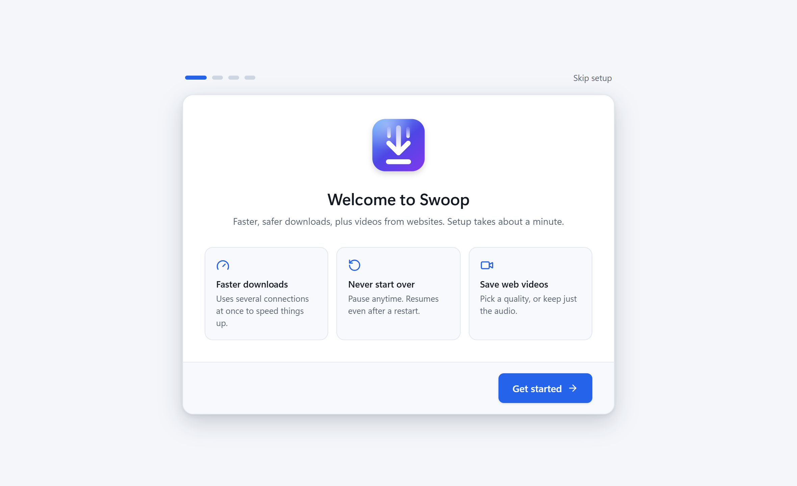
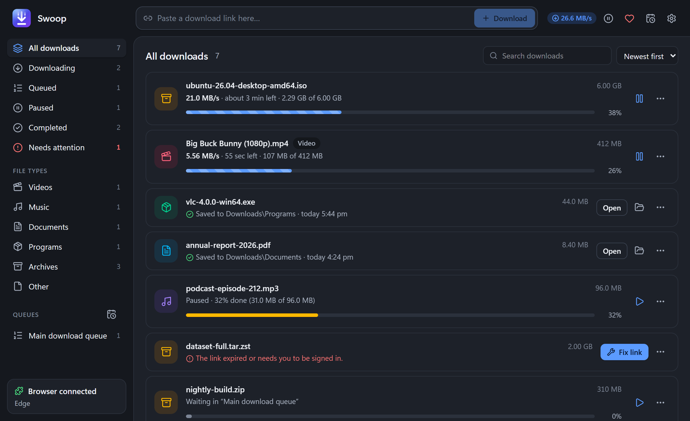
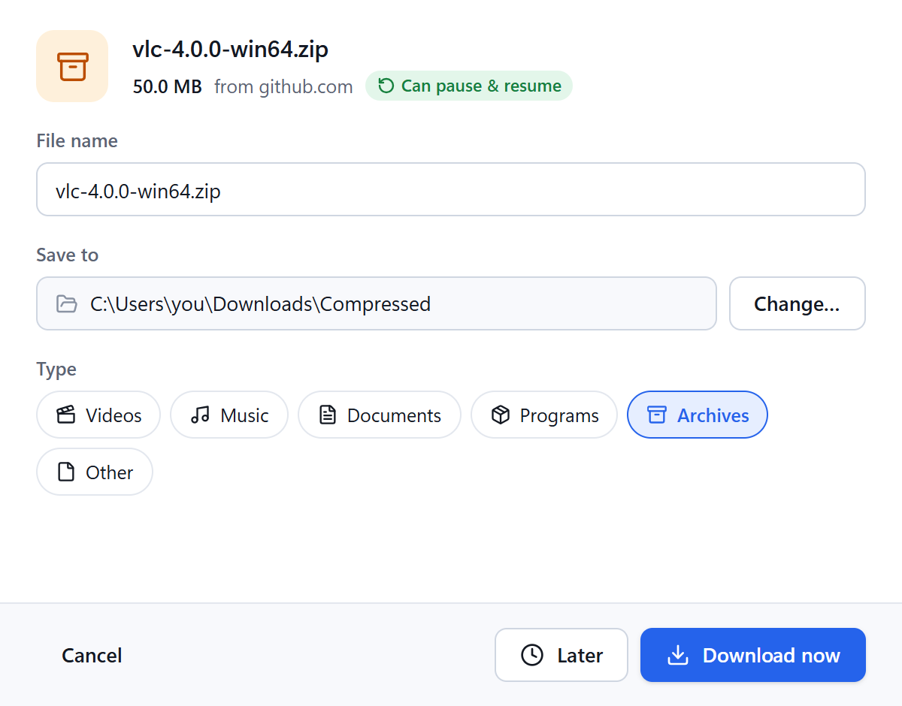
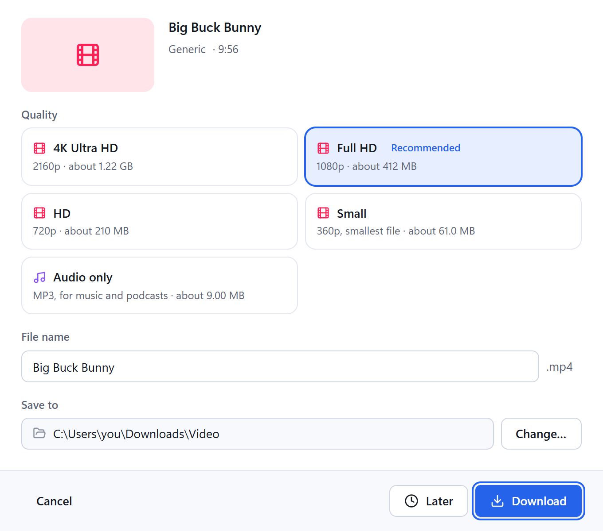
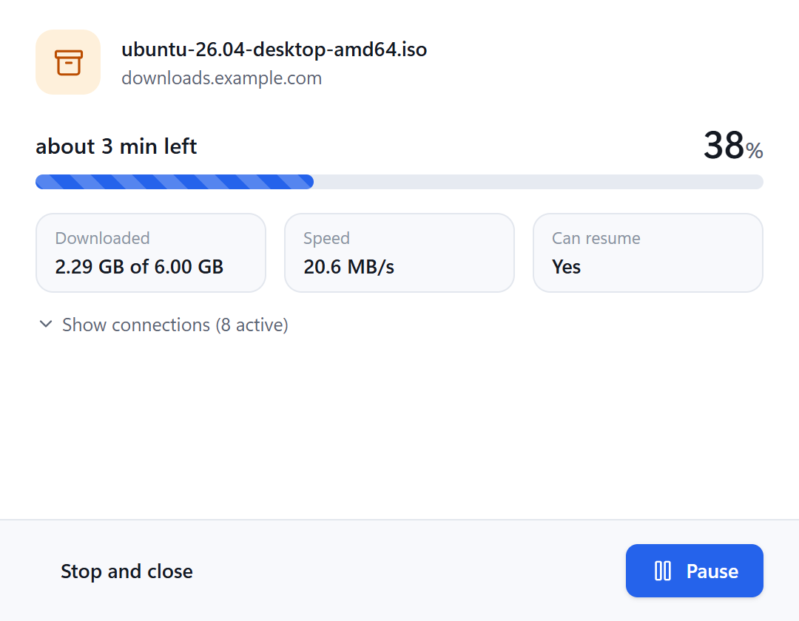
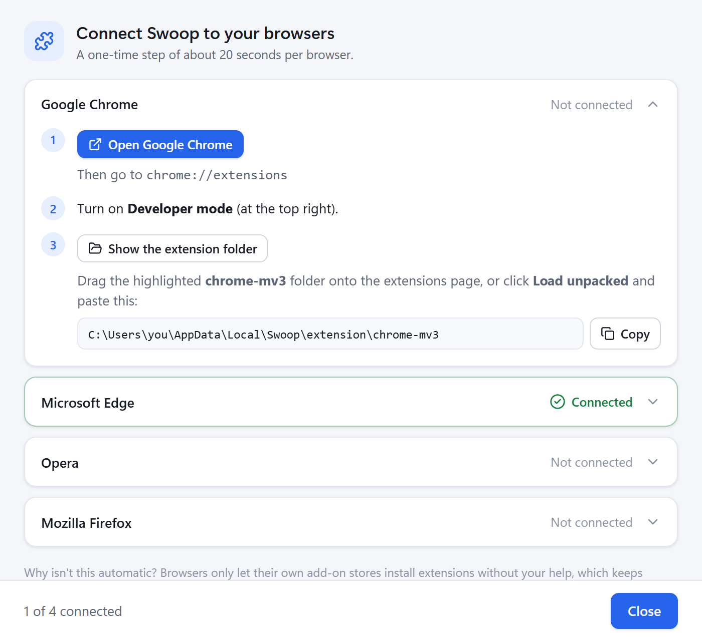
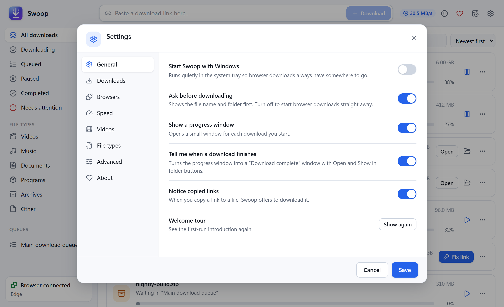
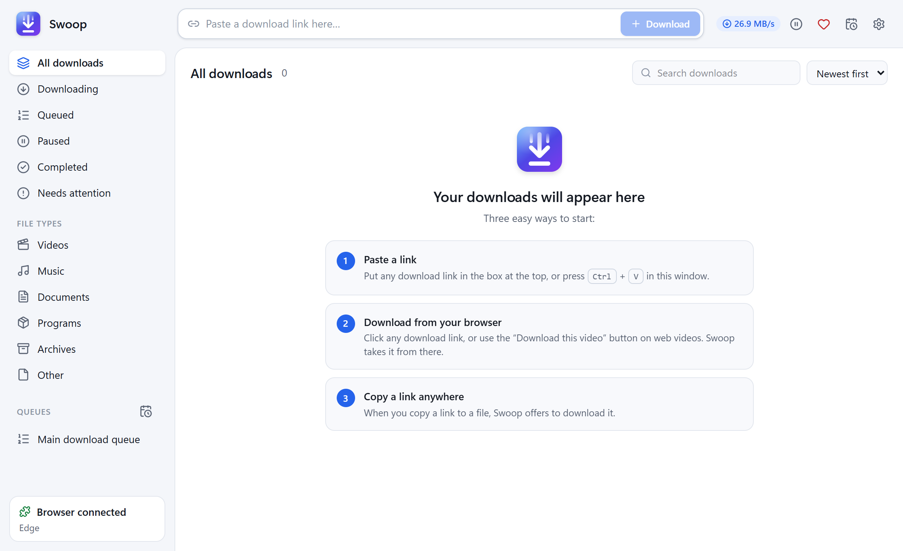

<div align="center">


# Swoop

**Fast, resumable downloads and web videos for Windows.**<br>
Free and open source, by Ali Studio.

<a href="https://github.com/OWNER/swoop-download-manager/releases/latest/download/Swoop-Setup-x64.exe"></a>

[](https://github.com/OWNER/swoop-download-manager/releases/latest)
[](LICENSE)

[](#-like-swoop)



</div>

## Why Swoop?

- **Faster downloads**: each file is split across up to 32 connections, and connections that finish early help the slower ones.
- **Never start over**: pause any time. Downloads resume even after a crash or a restart, and Swoop notices if the file changed on the server.
- **Works with your browser**: Chrome, Edge, Opera, Brave and Firefox. Clicking a download sends it to Swoop (hold **Alt** to keep it in the browser).
- **Save web videos**: a *Download this video* button appears on videos. Pick Full HD, 4K, or just the audio as MP3.
- **Easy to use**: paste a link, press **Ctrl+V**, or drag a link in. Clear status like "about 2 min left", and errors that tell you what to do.
- **Queues and schedule**: download overnight, then let the PC sleep or shut down.
- **Tidy folders**: videos, music, documents, programs and archives each get their own folder.
- **Light and dark mode**, following Windows.
- **No ads, no tracking, no account.**

## Download and install

1. **[Download Swoop-Setup-x64.exe](https://github.com/OWNER/swoop-download-manager/releases/latest/download/Swoop-Setup-x64.exe)** (about 4 MB) and run it. It installs for your user only, so no admin rights are needed.
2. If Windows shows **"Windows protected your PC"**, click **More info → Run anyway**. Swoop isn't code-signed yet (certificates are expensive), so Windows doesn't recognise the publisher.
3. Tick the browsers you use on the **Which browsers do you use?** page.
4. Swoop opens with a short **welcome tour** that helps you choose a download folder and connect your browsers (about 20 seconds each).

**For web videos** (YouTube, Instagram, X, Vimeo and [many more](https://github.com/yt-dlp/yt-dlp/blob/master/supportedsites.md)), Swoop uses two free tools you install once:

```powershell
winget install yt-dlp.yt-dlp
winget install Gyan.FFmpeg
```

Settings → Videos shows whether they were found. Normal file downloads work without them.

## Screenshots

| | |
|---|---|
| <br>Welcome tour | <br>Dark mode |
| <br>Download a file | <br>Choose a video quality |
| <br>Progress | <br>Connect your browsers |
| <br>Settings | <br>Getting started |

## 💝 Like Swoop?

Swoop is free and always will be. If it saves you time and you'd like to say thanks, you can send an **Amazon Pay gift card (amazon.in)** by email:

1. Open the **[Amazon Pay eGift Card page](https://www.amazon.in/Amazon-Pay-E-mail-Gift-Card/dp/B01LTHZYN0)**.
2. Choose any amount.
3. Enter **`farzad006@gmail.com`** as the recipient email.

It usually arrives within 15 minutes. Thank you, it really helps! (Amazon.in gift cards need an Indian payment card. A ⭐ star on this repo is a lovely thank-you too.)

Inside Swoop, the ♥ button (top right) opens the same page.

## Questions

<details>
<summary><b>Is it really free? Is it safe?</b></summary>

Yes. Swoop is open source under the MIT license, and every line is in this repository. It has no ads, no telemetry and no account. It only connects to the sites you download from.
</details>

<details>
<summary><b>Why do I have to connect the browser myself?</b></summary>

Browsers only let their own web stores add extensions automatically. That protects you from unwanted extensions, so a one-time step is needed. Swoop opens the right page and shows the folder to drag in. The extension files come with the installer.
</details>

<details>
<summary><b>Can it download Netflix, Prime Video, Disney+ or Spotify?</b></summary>

No. Those services lock their streams with DRM copy protection, and Swoop doesn't break it. Please only download content you have the right to download.
</details>

<details>
<summary><b>Firefox removes the extension when it restarts</b></summary>

Firefox only keeps add-ons that Mozilla has signed. Until Swoop's add-on is signed, load it again from `about:debugging` after a restart, or see [docs/DEVELOPMENT.md](docs/DEVELOPMENT.md) to sign your own copy for free.
</details>

<details>
<summary><b>How do I uninstall?</b></summary>

Windows Settings → Apps → Swoop → Uninstall. This also removes the browser connection. Remove the extension from your browser's extensions page.
</details>

<details>
<summary><b>A download stopped with "the link expired"</b></summary>

Some sites give each download a temporary link. Click **Fix link**, start the download again on the website, copy the new link and paste it. Swoop keeps everything downloaded so far.
</details>

## Build from source

You need Rust (stable, MSVC), Node.js 22+, and the Visual Studio C++ Build Tools.

```bash
cargo test --workspace                  # download engine, app, browser connector
npm --prefix extension install
npm --prefix extension run build        # browser extension builds
npm --prefix app install
npm --prefix app run tauri dev          # run Swoop with hot reload
npm --prefix app run installer          # release build + installer
```

Architecture, tests and release notes for contributors are in **[docs/DEVELOPMENT.md](docs/DEVELOPMENT.md)**. Bug reports and pull requests are welcome.

## Legal

Swoop is an independent project by Ali Studio. It isn't affiliated with Internet Download Manager (Tonec Inc.) or any browser maker, and it contains no code from them. Use it only for content you're allowed to download, and respect each site's terms.

## License

[MIT](LICENSE) © 2026 Ali Studio
